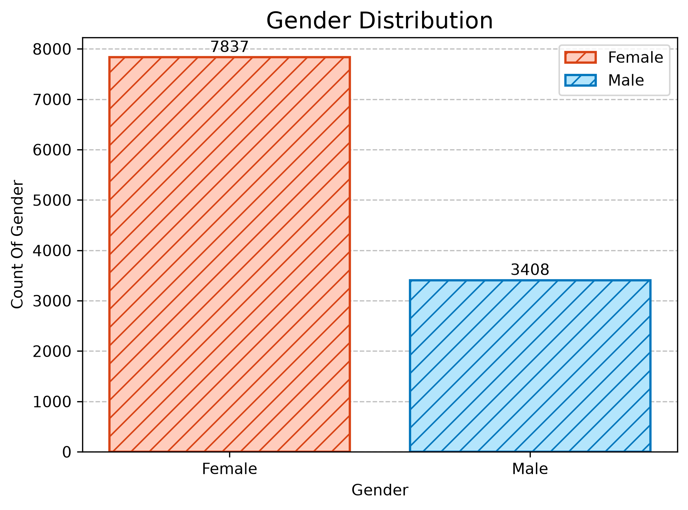
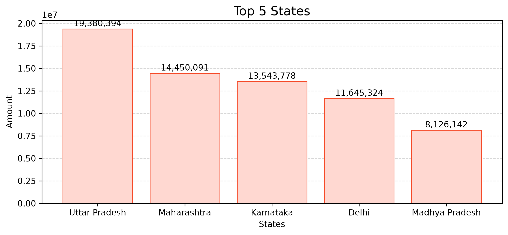
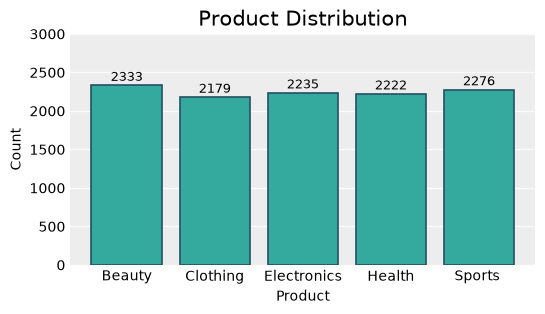
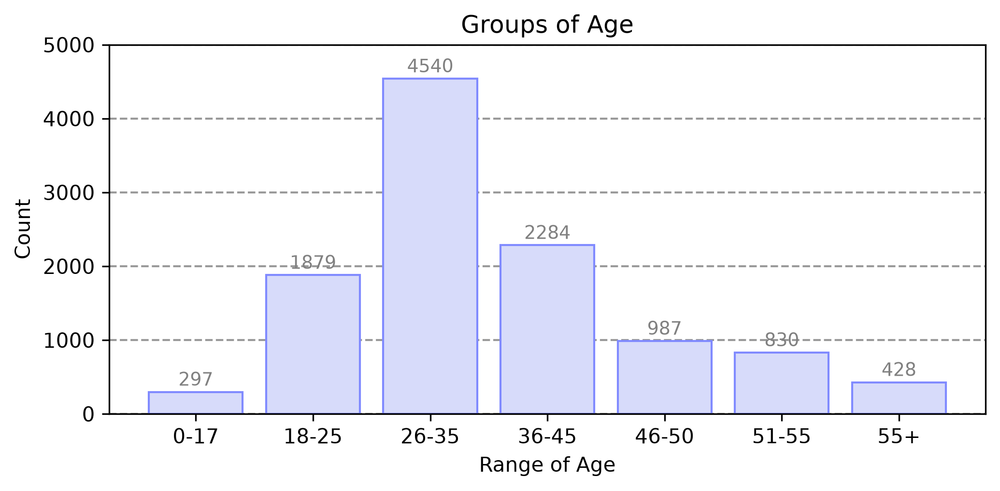

# 📊 Python Sales Data Analysis Project

## 🚀 About the Project

This project focuses on analyzing sales data using Python. The main objective is to explore customer and sales information, perform data cleaning, and generate meaningful insights through data visualization.

## 🛠️ Technologies & Libraries Used

- Python
- Pandas
- NumPy
- Matplotlib
- Seaborn
- Jupyter Notebook

## 📂 Project Structure

```text
Python-Sales-Data-Analysis/
│
├── Sales_Data_Analysis.ipynb
├── Sales_Data.csv
├── images/
│   ├── gender.png
│   ├── top_states.png
│   ├── category.png
│   └── age_group.png
│
└── README.md
```

## 🧹 Data Cleaning

- Removed unnecessary columns.
- Checked missing values.
- Standardized Gender values.
- Prepared data for analysis.

## 📈 Exploratory Data Analysis (EDA)

The following analysis was performed:

1. Gender Distribution
2. Age Group Distribution
3. Age Group vs Gender Analysis
4. Top 5 States by Sales
5. Product Category Analysis
6. Profession Distribution
7. Top 10 Customers by Sales

## 📸 Project Screenshots

### 1. Gender Distribution


### 2. Top 5 States by Sales


### 3. Product Category Analysis


### 4. Age Group Distribution


## ⚙️ How to Run This Project

**Step 1:** Clone the repository.

```bash
git clone https://github.com/your-username/Python-Sales-Data-Analysis.git
```

**Step 2:** Install required libraries.

```bash
pip install pandas numpy matplotlib seaborn jupyter
```

**Step 3:** Open Jupyter Notebook.

```bash
jupyter notebook
```

**Step 4:** Open `Sales_Data_Analysis.ipynb` and run the cells.

## 🎯 Key Learnings

- Data Cleaning and Preprocessing
- Exploratory Data Analysis (EDA)
- Data Visualization
- Working with Python Libraries
- Extracting Insights from Sales Data

## 👨‍💻 Author

**Ujjwal Saini**

Created as a Python Data Analysis learning project.

---

⭐ If you find this project useful, feel free to star this repository!

